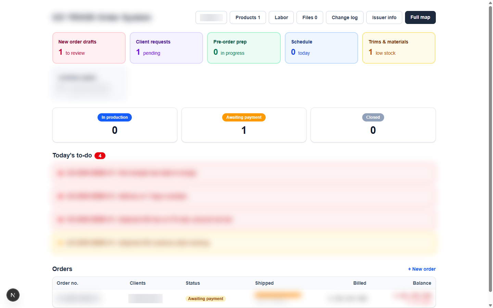

# I run my whole business alone, so I built my own OS with Claude Code (1/3)

I handle accounting, client management and marketing all by myself. 30 clients.
Keeping track of every order by hand was eating my whole day.
So the first thing I built was an order automation system.
That's how it started. (1/3)

Screens are from my own system. Client names and numbers are hidden.
