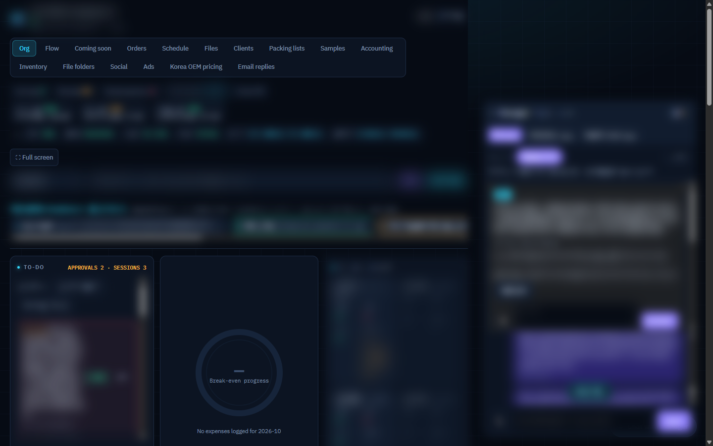

# From one order tool to a whole control room (2/3)

Then I kept adding one feature at a time...
and somehow it turned into a whole OS
This is the control room now. Everything runs through here. (2/3)

Screens are from my own system. Client names and numbers are hidden.
