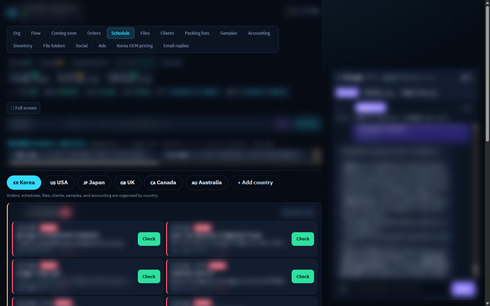
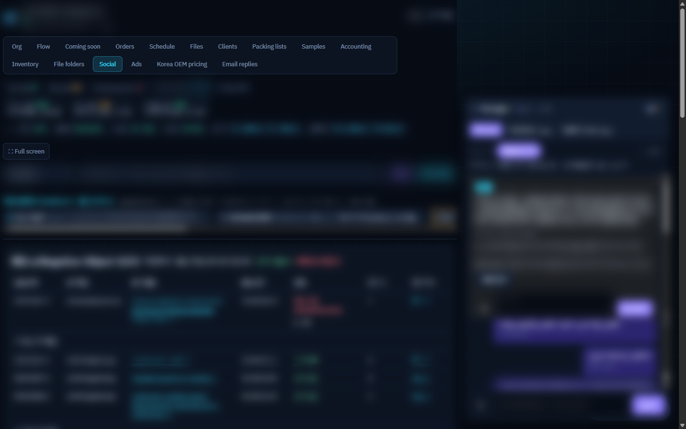
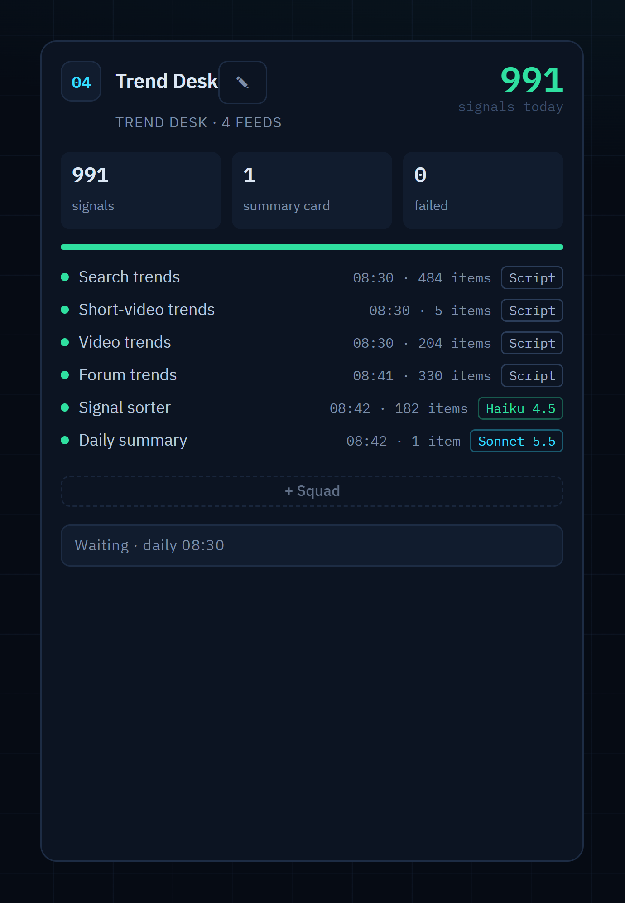
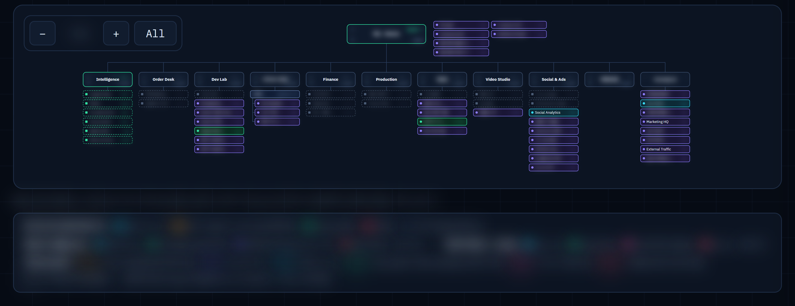
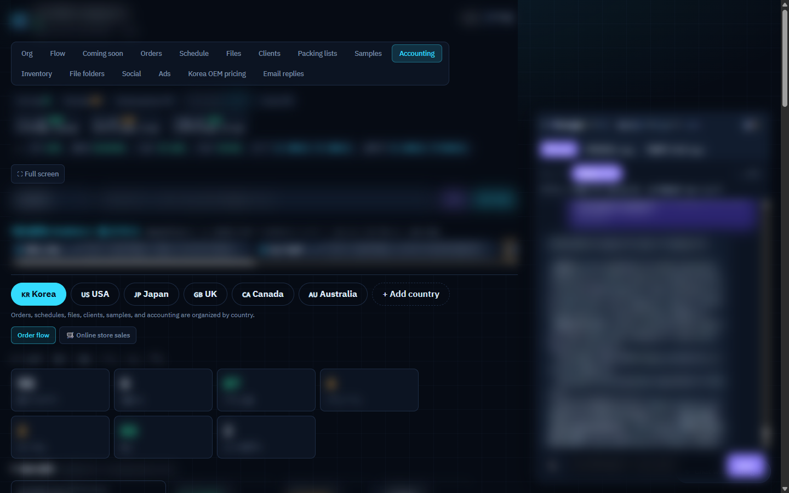
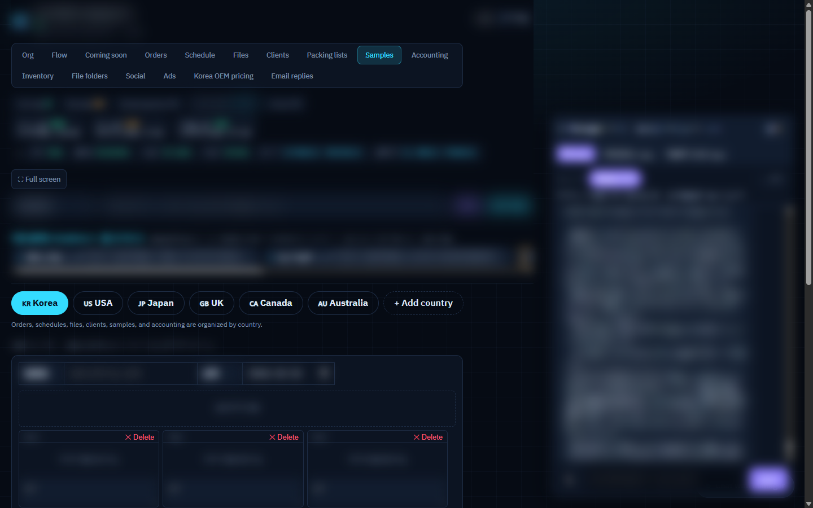

# What my one-person OS handles now (3/3)

What it handles now:
schedule, social media, trend tracking, marketing, accounting, samples.
Accounting, clients, marketing... I still do it all myself.
The system does the heavy lifting
AI is the best. Seriously. (3/3)

+ accounting and samples too.
All handled by me, through one system

Screens are from my own system. Client names and numbers are hidden.
